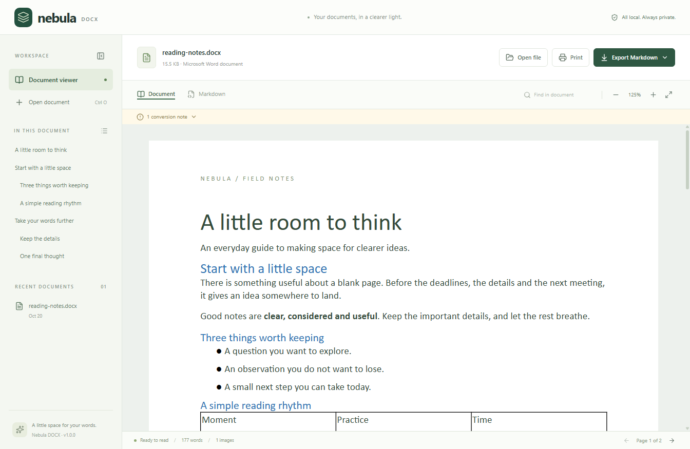
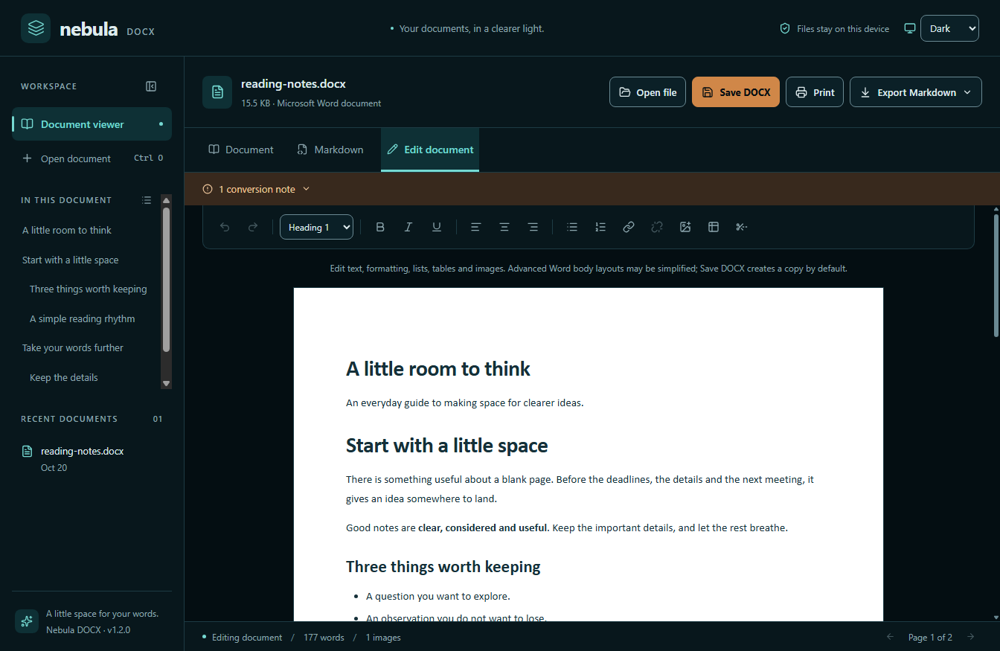

# Nebula DOCX

A quiet, offline home for Word documents. Open, preview and edit `.docx` files, print them, or take their content into Markdown. No Microsoft Word installation, account, upload, or internet connection is required.





Also available in [light mode](docs/images/light-theme.png), or choose **System** to follow Windows appearance.

## Download

Download `nebula-docx-1.2.0.exe` from [GitHub Releases](https://github.com/Porkstone/nebula-docx/releases/latest). Installer filenames include the release version; the installed application is named `nebula-docx.exe`. Supports Windows 10 and Windows 11, x64. The installer is unsigned; Windows may show an unknown-publisher prompt.

### Install with Chocolatey

Chocolatey project page: [nebula-docx on Chocolatey Community](https://community.chocolatey.org/packages/nebula-docx).

Version [1.2.0 has been submitted to Chocolatey](https://community.chocolatey.org/packages/nebula-docx/1.2.0) and is awaiting automated checks and moderation approval. The community installation command below becomes available after approval.

Once approved, [install Chocolatey](https://docs.chocolatey.org/en-us/choco/setup/) if needed, open **PowerShell as Administrator**, and run:

```powershell
choco install nebula-docx --yes
```

To update an existing installation:

```powershell
choco upgrade nebula-docx --yes
```

Before community approval, download `nebula-docx.1.2.0.nupkg` from [GitHub Releases](https://github.com/Porkstone/nebula-docx/releases/latest) into your **Downloads** folder, then install it from an administrator PowerShell window:

```powershell
choco install nebula-docx --version 1.2.0 --source "$env:USERPROFILE\Downloads" --yes
```

Package publication is handled manually after testing; CI does not publish packages.

## Features

- Open through the file picker, drag and drop, command-line file argument, or Windows **Open with**.
- Preview document pages, headings, tables, embedded images, headers, footers, and footnotes.
- Search text, navigate pages and the heading outline, zoom, and fit the document to the window.
- Switch to **Edit document** for text, headings, bold/italic/underline, alignment, lists, links, tables, local images and manual page breaks. Undo and redo work inside the editor.
- **Save DOCX** saves an edited copy through the Windows file dialog. Unsaved changes are protected when opening another file or closing the app.
- Print the document through the Windows print dialog, including **Microsoft Print to PDF**.
- Export a `.md` file with embedded images, or a ZIP containing Markdown and an `images/` folder.
- Reopen the eight most recent documents. Only file locations are saved locally; document contents are not cached.
- Choose **Light**, **Dark**, or **System** from the appearance selector in the top-right corner. The preference is saved locally; System follows Windows appearance changes. Word document pages keep their own colours for preview, editing and printing.

Keyboard shortcuts: **Ctrl+O** open, **Ctrl+F** find, **Ctrl+P** print, **Ctrl+S** save a DOCX copy, **Ctrl+Shift+M** export Markdown. In edit mode use **Ctrl+Z / Ctrl+Shift+Z** for undo/redo and **Ctrl+B / Ctrl+I / Ctrl+U** for formatting. **Enter/Shift+Enter** advances through search results in the viewer.

## Format support and limitations

DOCX is supported; legacy `.doc`, `.docm`, and encrypted/password-protected documents are not. Files are limited to 40 MB compressed, 120 MB expanded, and 3,000 ZIP entries.

The viewer uses browser rendering, so layouts, fonts, floating shapes, charts, equations, tracked changes, text boxes and complex tables may differ from Word. Preview pagination follows saved/manual page breaks and section settings; it does not reproduce Word's automatic page layout. Print pagination can also depend on the chosen printer and paper size.

Edit mode uses a simplified document layout. Saving edits rebuilds the supported body content and retains the original headers, footers, page size, margins and final section settings. Advanced body formatting, fields, footnote references, comments, text boxes, tracked changes and multiple section layouts may be simplified or lost in the edited copy. Review the preview before sharing complex documents. Opening edit mode without changing anything, or undoing back to the original content, saves an exact copy of the original DOCX. Images added to the body are embedded as PNG; large images are scaled to a maximum of 1600 pixels on the longest side.

Switching back to Document or Markdown, printing, and exporting all use the current draft. Exporting Markdown does not mark an unsaved DOCX draft as saved. Save dialogs default to an `-edited.docx` copy; the original is changed only if you explicitly choose it in the Windows save dialog. DOCX saves use a temporary file and atomic rename.

Markdown preserves supported headings, emphasis, lists, hyperlinks, images and simple tables. The first row of a table becomes its Markdown header; paragraph breaks inside cells become `<br>`. Page layout, headers and footers do not map into Markdown. Some Markdown readers do not display embedded data images; use the ZIP export for those readers. Review conversion notes and exported content for complex documents.

## Privacy and security

All processing is local. The installed app blocks network requests, does not run macros, disables Node.js in the renderer, and uses Electron sandboxing and context isolation. The document preview runs in a scriptless iframe and is sanitised with DOMPurify. Embedded HTML chunks and external-file access are disabled. OS file and export dialogs are handled through a narrow, sender-validated preload bridge.

Recent file locations are stored in `%APPDATA%/Nebula DOCX/recent-files.json`. To clear history, close the app and delete that file. Uninstalling keeps these preferences.

The appearance preference is stored in `%APPDATA%/Nebula DOCX/settings.json`. Delete that file with the app closed to reset to System appearance.

## Development

Requires Node.js 24 or newer and pnpm 11. On Windows:

```powershell
pnpm install --frozen-lockfile
pnpm dev
```

The frontend uses React, TypeScript, Vite, Tailwind CSS and Lucide. Electron provides native open/save and print dialogs. `docx-preview` renders documents; Mammoth and Turndown convert their structure to Markdown. No backend or authentication is needed.

```powershell
pnpm build          # TypeScript and production renderer
pnpm test           # Actual Electron integration test against the built renderer
pnpm notices        # Regenerate third-party license notices
pnpm dist:win       # Build the Windows x64 NSIS installer
```

The integration tests exercise opening, two-page layout, tables, images, Unicode, search, pagination, zoom, Markdown, native save dialogs, both export formats, isolated printing to a two-page PDF, renderer isolation and recovery after a corrupt file. Editor tests cover formatting, undo/redo, table changes, image insertion, DOCX save/reopen, original/header/footer/page-setting preservation, unsaved-change protection, and edited preview/export/printing. Tests stub file dialogs and the final OS print dialog; they do not send paper to a physical printer.

Regenerate test fixtures with `pnpm fixtures`. The fixture includes an intentional page break, table, embedded image, hyperlink, Unicode, headers and footers. Regenerate the application icon on Windows with `powershell -File scripts/create-icon.ps1`.

## Release and Chocolatey

See [RELEASING.md](RELEASING.md) for reproducible build, checksum, installer verification and submission instructions. Chocolatey submissions require automated checks and moderator approval; a pending submission is not an approved package.

## License

MIT. Third-party licenses are included in `THIRD-PARTY-NOTICES.txt`; Electron and Chromium notices also ship with the app. Nebula DOCX is independent of Microsoft and is not affiliated with or endorsed by Microsoft.
